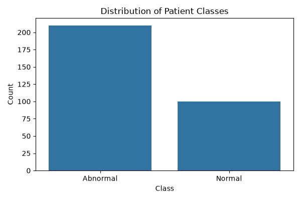
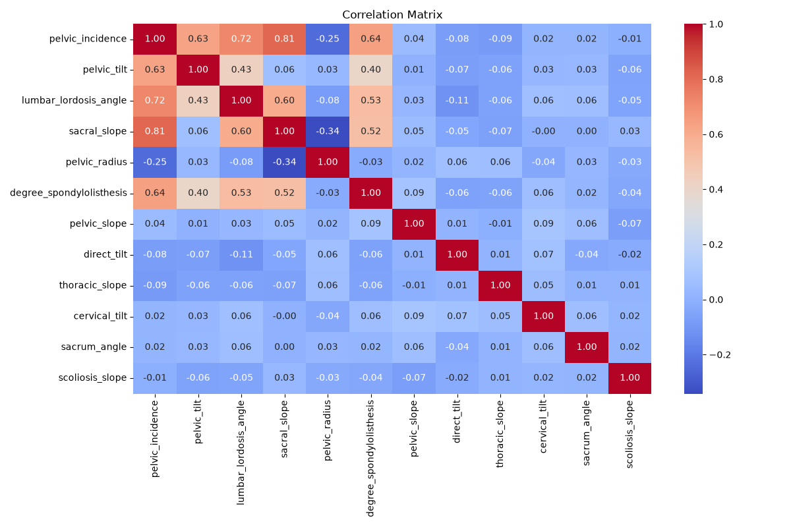
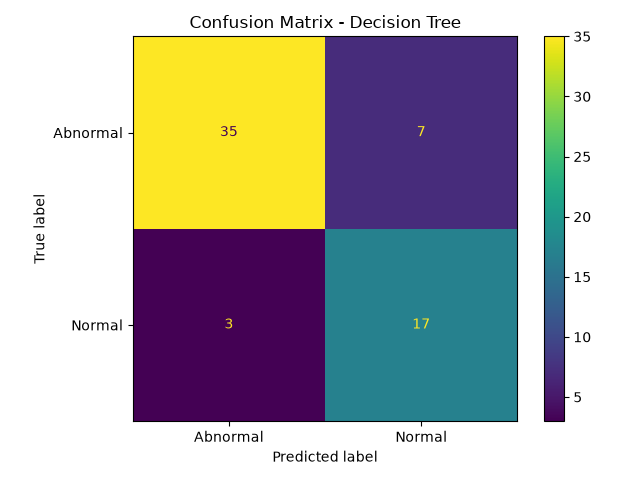

# Lower Back Pain Prediction

A machine learning project that analyzes biomechanical spine measurements to classify patients as **Normal** or **Abnormal**.

This project was built as an educational data science project using Python, exploratory data analysis, data visualization, and several machine learning classification models.

> **Important note:** this project is for learning purposes only. It should not be used as a real medical diagnostic tool.

## AI transparency

This project was developed with the help of **GPT-5.5**. The model was used as an assistant during design and implementation; the project decisions, verification, and responsibility for the result remain human.

---

## Project Overview

Lower back pain is a common health issue, but this dataset does not directly measure pain intensity. Instead, it contains biomechanical measurements related to the spine and pelvis, and each patient is classified as either:

- **Normal**
- **Abnormal**

The goal of this project is to build a machine learning model that can predict the class of a patient based on these biomechanical features.

---

## Dataset

The dataset used in this project comes from Kaggle:

**Lower Back Pain Symptoms Dataset**  
https://www.kaggle.com/datasets/sammy123/lower-back-pain-symptoms-dataset

The dataset contains:

- **310 patients**
- **12 numerical biomechanical features**
- **1 target variable**: `class`

The original dataset contained generic column names such as `Col1`, `Col2`, etc. These were renamed to more understandable feature names.

---

## Features

The dataset includes the following biomechanical variables:

| Feature                    | Description                  |
| -------------------------- | ---------------------------- |
| `pelvic_incidence`         | Pelvic incidence measurement |
| `pelvic_tilt`              | Pelvic tilt measurement      |
| `lumbar_lordosis_angle`    | Lumbar lordosis angle        |
| `sacral_slope`             | Sacral slope measurement     |
| `pelvic_radius`            | Pelvic radius measurement    |
| `degree_spondylolisthesis` | Degree of spondylolisthesis  |
| `pelvic_slope`             | Pelvic slope measurement     |
| `direct_tilt`              | Direct tilt measurement      |
| `thoracic_slope`           | Thoracic slope measurement   |
| `cervical_tilt`            | Cervical tilt measurement    |
| `sacrum_angle`             | Sacrum angle measurement     |
| `scoliosis_slope`          | Scoliosis slope measurement  |

The target variable is:

| Target  | Values               |
| ------- | -------------------- |
| `class` | `Normal`, `Abnormal` |

---

## Project Structure

```text
back-pain/
│
├── data/
│   └── Dataset_spine.csv
│
├── images/
│   ├── class_distribution.png
│   ├── correlation_matrix.png
│   ├── model_comparison.png
│   ├── confusion_matrix.png
│   ├── feature_importance.png
│   └── boxplot_*.png
│
├── notebooks/
│   └── analysis.ipynb
│
├── src/
│
├── README.md
├── requirements.txt
└── .gitignore
```

---

## Tools and Libraries

This project uses:

- Python
- Pandas
- NumPy
- Matplotlib
- Seaborn
- Scikit-learn
- Jupyter Notebook
- Git and GitHub

---

## Methodology

The project follows a standard data science workflow:

1. Load the dataset
2. Inspect the data structure
3. Clean and rename the columns
4. Check for missing values
5. Explore the target variable distribution
6. Visualize relationships between variables
7. Prepare the data for machine learning
8. Train several classification models
9. Compare model performance
10. Analyze the best model using a confusion matrix and feature importance

---

## Data Cleaning

The original dataset included one unnecessary column called `Unnamed: 13`, which contained descriptive text rather than useful patient data.

This column was removed.

The original column names were renamed from generic names such as:

```text
Col1, Col2, Col3, ...
```

to more meaningful names such as:

```text
pelvic_incidence, pelvic_tilt, lumbar_lordosis_angle, ...
```

No missing values were found in the dataset.

---

## Exploratory Data Analysis

### Class Distribution

The dataset contains more `Abnormal` patients than `Normal` patients:

```text
Abnormal: 210
Normal:   100
```

This means the dataset is moderately imbalanced.



---

### Correlation Matrix

A correlation matrix was used to understand relationships between the numerical features.



Correlation helps identify variables that move together and variables that may contain similar information.

---

### Feature Comparison by Class

Boxplots were created to compare each biomechanical feature between `Normal` and `Abnormal` patients.

These visualizations help identify which measurements may differ between the two patient groups.

Example boxplots are saved in the `images/` folder.

---

## Machine Learning Preparation

The dataset was separated into:

```text
X = biomechanical features
y = class to predict
```

The target variable was encoded numerically:

```text
Abnormal → 0
Normal   → 1
```

The dataset was split into training and testing sets:

```text
80% training data
20% testing data
```

The numerical features were standardized using `StandardScaler`.

Standardization was used because some models, such as Logistic Regression, SVM, and KNN, are sensitive to feature scales.

This transformation does not modify the original dataset. It only creates scaled versions of the training and testing data for model training.

---

## Models Trained

Several classification models were trained and compared:

- Logistic Regression
- Decision Tree
- Random Forest
- Support Vector Machine
- K-Nearest Neighbors

The models were evaluated using:

- Accuracy
- Precision
- Recall
- F1-score

---

## Model Results

The Decision Tree model achieved the best performance on the test set.

| Model               | Accuracy | Precision | Recall | F1-score |
| ------------------- | -------: | --------: | -----: | -------: |
| Decision Tree       |   0.8387 |    0.7083 | 0.8500 |   0.7727 |
| Random Forest       |   0.8065 |    0.6818 | 0.7500 |   0.7143 |
| Logistic Regression |   0.8065 |    0.7000 | 0.7000 |   0.7000 |
| SVM                 |   0.8065 |    0.7000 | 0.7000 |   0.7000 |
| KNN                 |   0.7581 |    0.6190 | 0.6500 |   0.6341 |


---

## Confusion Matrix

The best model was the Decision Tree.

Its confusion matrix was:

```text
                 Predicted Abnormal   Predicted Normal
True Abnormal            35                  7
True Normal               3                 17
```

This means:

- 35 abnormal patients were correctly classified as abnormal
- 17 normal patients were correctly classified as normal
- 7 abnormal patients were incorrectly classified as normal
- 3 normal patients were incorrectly classified as abnormal



---

## Feature Importance

Feature importance was used to understand which variables contributed most to the Decision Tree model.


This helps make the model more interpretable by showing which biomechanical measurements were most useful for classification.

---

## Key Findings

- The dataset contains no missing values.
- The classes are moderately imbalanced, with more `Abnormal` cases than `Normal` cases.
- The Decision Tree model achieved the best F1-score on the test set.
- The model performs better on the `Abnormal` class than on the `Normal` class.
- Some biomechanical features appear more useful than others for classification.

---

## Limitations

This project has several limitations:

- The dataset is small, with only 310 patients.
- The data does not include a direct pain intensity score.
- The model predicts `Normal` or `Abnormal`, not the real level of lower back pain.
- Results may vary depending on the train/test split.
- The project is educational and should not be used for real medical diagnosis.

---

## How to Run the Project

Clone the repository:

```bash
git clone https://github.com/YOUR-USERNAME/YOUR-REPOSITORY-NAME.git
```

Go into the project folder:

```bash
cd YOUR-REPOSITORY-NAME
```

Install the required libraries:

```bash
pip install -r requirements.txt
```

Open the notebook:

```bash
notebooks/analysis.ipynb
```

Then run all cells in order.

---

## Requirements

The `requirements.txt` file should contain:

```text
pandas
numpy
matplotlib
seaborn
scikit-learn
```

---

## Conclusion

This project demonstrates a complete beginner-friendly machine learning workflow using a medical-style classification dataset.

The final model can classify patients as `Normal` or `Abnormal` based on biomechanical spine and pelvis measurements.

The Decision Tree model achieved the best performance in this experiment, with an accuracy of approximately **83.9%** and an F1-score of approximately **0.77** for the `Normal` class.

However, because the dataset is small and does not directly measure pain intensity, the model should only be considered an educational machine learning example.

---

## Author

**Alban Gerschheimer**

Student project in data science and machine learning.
