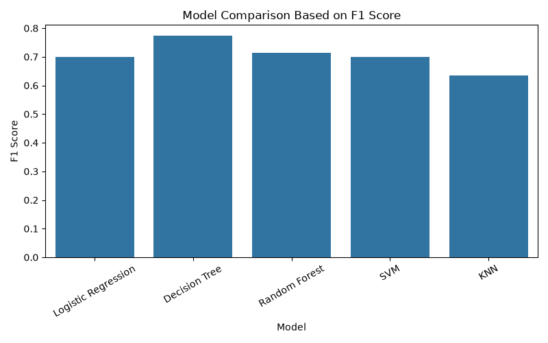
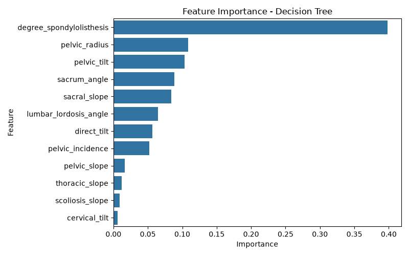

<div align="center">

# Lower Back Pain Prediction

**Classifying patients as `Normal` or `Abnormal` from biomechanical spine and pelvis measurements.**

[](https://github.com/albangerschheimer/Lower-Back-Pain-Prediction/actions/workflows/ci.yml)
[](LICENSE)
[](https://www.python.org/)
[](https://scikit-learn.org/)

**Language / Langue — [English](#english) · [Français](#français)**

</div>

> ⚠️ **Educational project only — not a medical diagnostic tool.**
> **Projet pédagogique uniquement — ce n'est pas un outil de diagnostic médical.**

---

<a id="english"></a>

## English

An end-to-end machine learning project on a small medical-style dataset: load,
clean, explore, train five classifiers, and analyse the winner.

Lower back pain is common, but this dataset does not measure pain intensity. It
contains biomechanical measurements of the spine and pelvis, and labels each
patient `Normal` or `Abnormal`. The goal is to predict that label.

### Results

The Decision Tree gives the best F1-score on the test set.

| Model | Accuracy | Precision | Recall | F1-score |
| --- | ---: | ---: | ---: | ---: |
| **Decision Tree** | **0.8387** | 0.7083 | 0.8500 | **0.7727** |
| Random Forest | 0.8065 | 0.6818 | 0.7500 | 0.7143 |
| Logistic Regression | 0.8065 | 0.7000 | 0.7000 | 0.7000 |
| SVM | 0.8065 | 0.7000 | 0.7000 | 0.7000 |
| KNN | 0.7581 | 0.6190 | 0.6500 | 0.6341 |



Every number above is pinned by [`tests/test_analysis.py`](tests/test_analysis.py)
and re-checked by CI, so the table cannot silently drift away from the code.

#### Confusion matrix — Decision Tree

```text
                 Predicted Abnormal   Predicted Normal
True Abnormal            35                   7
True Normal               3                  17
```

The model is clearly better at recognising `Abnormal` patients (35/42) than
`Normal` ones (17/20).


#### Feature importance

`degree_spondylolisthesis` dominates the decision by a wide margin — it alone
accounts for about 40% of the tree's importance.



### Dataset

[Lower Back Pain Symptoms Dataset](https://www.kaggle.com/datasets/sammy123/lower-back-pain-symptoms-dataset)
on Kaggle: **310 patients**, **12 numerical features**, 1 target.

| Feature | Feature |
| --- | --- |
| `pelvic_incidence` | `direct_tilt` |
| `pelvic_tilt` | `thoracic_slope` |
| `lumbar_lordosis_angle` | `cervical_tilt` |
| `sacral_slope` | `sacrum_angle` |
| `pelvic_radius` | `scoliosis_slope` |
| `degree_spondylolisthesis` | `pelvic_slope` |

Target: `class` ∈ {`Normal`, `Abnormal`} — 100 Normal, 210 Abnormal.

The raw file ships generic `Col1`…`Col12` headers plus a trailing `Unnamed: 13`
column holding free text rather than patient data. `load_data()` drops that
column and applies the documented names. There are no missing values.


### Method

1. Load the CSV, drop `Unnamed: 13`, rename the columns
2. Check missing values and the class balance
3. Explore correlations and per-class distributions
4. Encode the target — `Abnormal` → 0, `Normal` → 1
5. Split 80/20, **stratified** so both sides keep the class balance
6. Standardise with `StandardScaler` (Logistic Regression, SVM and KNN are scale-sensitive)
7. Train Logistic Regression, Decision Tree, Random Forest, SVM and KNN
8. Compare on accuracy, precision, recall and F1-score
9. Inspect the winner with a confusion matrix and feature importance

`random_state=42` throughout, so every run reproduces the table above.

### Project structure

```text
Lower-Back-Pain-Prediction/
├── data/
│   └── Dataset_spine.csv       # Raw Kaggle dataset
├── images/                     # Figures used in this README
├── notebooks/
│   └── analysis.ipynb          # Step-by-step walkthrough
├── src/
│   └── analysis.py             # The reusable pipeline
├── tests/
│   └── test_analysis.py        # Pins the published results
├── requirements.txt
└── .github/workflows/ci.yml
```

### Running it

```bash
git clone https://github.com/albangerschheimer/Lower-Back-Pain-Prediction.git
cd Lower-Back-Pain-Prediction

python -m venv .venv
source .venv/bin/activate          # Windows: .venv\Scripts\activate

pip install -r requirements.txt
```

Run the whole analysis and print the metrics:

```bash
python src/analysis.py
```

Regenerate the figures in `images/`:

```bash
python src/analysis.py --figures
```

Open the notebook:

```bash
jupyter notebook notebooks/analysis.ipynb
```

Run the tests:

```bash
python -m unittest discover -s tests -t .
```

### Key findings

- No missing values in the dataset.
- The classes are moderately imbalanced — 210 `Abnormal` against 100 `Normal`.
- The Decision Tree gets the best F1-score, beating both ensembles.
- The model performs better on `Abnormal` than on `Normal`.
- `degree_spondylolisthesis` is by far the most informative measurement.

### Limitations

- Only 310 patients — small enough that the split matters a lot.
- No direct pain intensity score in the data.
- The model predicts `Normal` / `Abnormal`, not a real level of back pain.
- Educational project. **Do not use it for medical diagnosis.**

### AI transparency

This project was developed with the help of **GPT-5.5**. The model was used as
an assistant during design and implementation; the project decisions, the
verification and the responsibility for the result remain human.

### License

[MIT](LICENSE) © 2026 Alban Gerschheimer. The dataset remains subject to its own
Kaggle terms.

---

<a id="français"></a>

## Français

Un projet de machine learning de bout en bout sur un petit jeu de données de
type médical : charger, nettoyer, explorer, entraîner cinq classifieurs et
analyser le gagnant.

La lombalgie est fréquente, mais ce dataset ne mesure pas l'intensité de la
douleur. Il contient des mesures biomécaniques du rachis et du bassin, et
étiquette chaque patient `Normal` ou `Abnormal`. L'objectif est de prédire cette
étiquette.

### Résultats

L'arbre de décision obtient le meilleur F1-score sur le jeu de test.

| Modèle | Accuracy | Precision | Recall | F1-score |
| --- | ---: | ---: | ---: | ---: |
| **Decision Tree** | **0,8387** | 0,7083 | 0,8500 | **0,7727** |
| Random Forest | 0,8065 | 0,6818 | 0,7500 | 0,7143 |
| Logistic Regression | 0,8065 | 0,7000 | 0,7000 | 0,7000 |
| SVM | 0,8065 | 0,7000 | 0,7000 | 0,7000 |
| KNN | 0,7581 | 0,6190 | 0,6500 | 0,6341 |


Chacun de ces chiffres est figé par [`tests/test_analysis.py`](tests/test_analysis.py)
et revérifié par la CI : le tableau ne peut pas dériver silencieusement du code.

#### Matrice de confusion — Decision Tree

```text
                    Prédit Abnormal   Prédit Normal
Vrai Abnormal              35               7
Vrai Normal                 3              17
```

Le modèle reconnaît nettement mieux les patients `Abnormal` (35/42) que les
`Normal` (17/20).


#### Importance des variables

`degree_spondylolisthesis` domine largement la décision — à elle seule, environ
40 % de l'importance de l'arbre.


### Jeu de données

[Lower Back Pain Symptoms Dataset](https://www.kaggle.com/datasets/sammy123/lower-back-pain-symptoms-dataset)
sur Kaggle : **310 patients**, **12 variables numériques**, 1 cible.

| Variable | Variable |
| --- | --- |
| `pelvic_incidence` | `direct_tilt` |
| `pelvic_tilt` | `thoracic_slope` |
| `lumbar_lordosis_angle` | `cervical_tilt` |
| `sacral_slope` | `sacrum_angle` |
| `pelvic_radius` | `scoliosis_slope` |
| `degree_spondylolisthesis` | `pelvic_slope` |

Cible : `class` ∈ {`Normal`, `Abnormal`} — 100 Normal, 210 Abnormal.

Le fichier brut porte des en-têtes génériques `Col1`…`Col12` plus une colonne
finale `Unnamed: 13` contenant du texte libre et non des données patient.
`load_data()` supprime cette colonne et applique les noms documentés. Aucune
valeur manquante.


### Méthode

1. Charger le CSV, supprimer `Unnamed: 13`, renommer les colonnes
2. Vérifier les valeurs manquantes et l'équilibre des classes
3. Explorer les corrélations et les distributions par classe
4. Encoder la cible — `Abnormal` → 0, `Normal` → 1
5. Découper 80/20, **stratifié** pour conserver l'équilibre des classes des deux côtés
6. Standardiser avec `StandardScaler` (la régression logistique, le SVM et le KNN sont sensibles à l'échelle)
7. Entraîner Logistic Regression, Decision Tree, Random Forest, SVM et KNN
8. Comparer sur accuracy, precision, recall et F1-score
9. Analyser le gagnant via matrice de confusion et importance des variables

`random_state=42` partout : chaque exécution reproduit le tableau ci-dessus.

### Structure du projet

```text
Lower-Back-Pain-Prediction/
├── data/
│   └── Dataset_spine.csv       # Jeu de données Kaggle brut
├── images/                     # Figures utilisées dans ce README
├── notebooks/
│   └── analysis.ipynb          # Déroulé pas à pas
├── src/
│   └── analysis.py             # Le pipeline réutilisable
├── tests/
│   └── test_analysis.py        # Fige les résultats publiés
├── requirements.txt
└── .github/workflows/ci.yml
```

### Lancer le projet

```bash
git clone https://github.com/albangerschheimer/Lower-Back-Pain-Prediction.git
cd Lower-Back-Pain-Prediction

python -m venv .venv
source .venv/bin/activate          # Windows : .venv\Scripts\activate

pip install -r requirements.txt
```

Lancer toute l'analyse et afficher les métriques :

```bash
python src/analysis.py
```

Régénérer les figures dans `images/` :

```bash
python src/analysis.py --figures
```

Ouvrir le notebook :

```bash
jupyter notebook notebooks/analysis.ipynb
```

Lancer les tests :

```bash
python -m unittest discover -s tests -t .
```

### Enseignements

- Aucune valeur manquante dans le jeu de données.
- Les classes sont modérément déséquilibrées — 210 `Abnormal` contre 100 `Normal`.
- L'arbre de décision obtient le meilleur F1-score, devant les deux ensembles.
- Le modèle est meilleur sur `Abnormal` que sur `Normal`.
- `degree_spondylolisthesis` est de loin la mesure la plus informative.

### Limites

- Seulement 310 patients — assez peu pour que le découpage compte beaucoup.
- Pas de score direct d'intensité de la douleur dans les données.
- Le modèle prédit `Normal` / `Abnormal`, pas un vrai niveau de lombalgie.
- Projet pédagogique. **À ne pas utiliser pour un diagnostic médical.**

### Transparence sur l'IA

Ce projet a été développé avec l'aide de **GPT-5.5**. Le modèle a servi
d'assistant pendant la conception et l'implémentation ; les décisions, les
vérifications et la responsabilité du résultat restent humaines.

### Licence

[MIT](LICENSE) © 2026 Alban Gerschheimer. Le jeu de données reste soumis à ses
propres conditions Kaggle.
